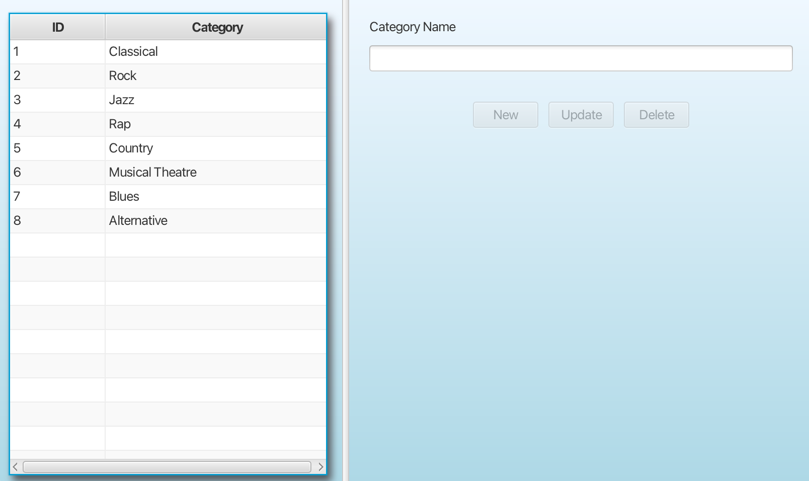
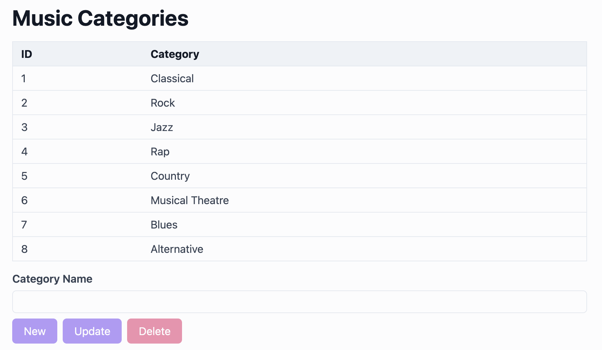
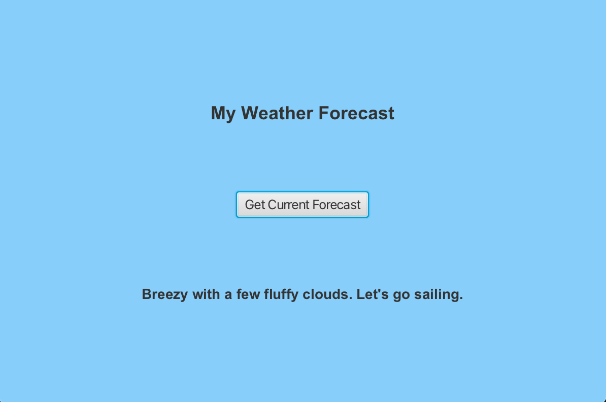
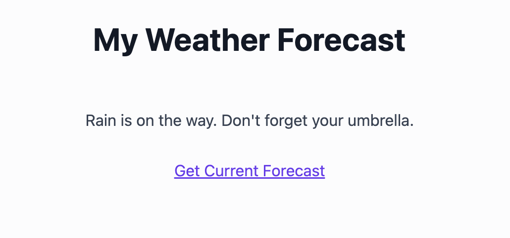

# JavaFX to Angular migration study

This repository shows a JavaFX desktop UI replaced by an Angular web UI. The Spring Boot backends and
their REST and server-sent events (SSE) API stay unchanged, so the new UI is correct when it behaves
like the old one against the same servers.

The starting point is the open-source
[JavaFX-SpringBoot-Samples](https://github.com/gailasgteach/JavaFX-SpringBoot-Samples) project. The
repository keeps both versions so you can compare them:

- [`initial-state/`](initial-state/) is the original project, unmodified: JavaFX desktop clients over
  Spring Boot servers.
- [`final-state/`](final-state/) is the migrated project: an Angular app and the same Spring Boot
  servers in one Nx workspace.

## Before and after

The Music screen lists categories in a table, with a name field and **New**, **Update**, and
**Delete** buttons. The Angular version keeps the same data, controls, and button rules. The first
screenshot shows the JavaFX client, and the second shows the Angular screen.





The Weather screen shows a forecast that the server pushes every 1.5 seconds, and a control that
opens a snapshot of the latest value. The first screenshot shows the JavaFX client, and the second
shows the Angular screen.





## What changed

The migration replaced only the presentation layer:

- FXML views and controllers, wired to Spring through Gluon Ignite, became Angular standalone
  components with signals.
- Background work with `javafx.concurrent.Task` and `Platform.runLater` became RxJS observables and a
  `loading` signal that drives a spinner.
- The two Music clients differed only in threading: one blocked the UI thread, and the other ran a
  background `Task` with a 2.5-second `Thread.sleep` to keep its spinner visible. Browser requests are
  asynchronous, so both became one screen and the delay was dropped.
- Scene swapping became Angular routes that load lazily and work as deep links: `/music`, `/weather`,
  and `/weather/latest`.
- The hardcoded `http://localhost:8080` became an `API_BASE_URL` injection token. The app calls the
  API on its own origin: in development, the Angular dev server forwards the calls to port 8080, and
  in production, a small Node.js server does the same. The browser makes no cross-origin calls, so the
  Spring servers need no CORS configuration.
- The Weather screen shows a message when the stream fails or sends nothing for 10 seconds. The
  original client only logged the error, so its forecast stopped changing without notice.
- Separate Maven builds became one Nx workspace that builds, tests, and serves both the Angular app
  and the Maven servers.

`IgniteDemo`, a minimal Gluon Ignite example with no backend, has no counterpart in the migrated
project.

## Repository layout

The migrated project in `final-state/` has the following parts:

- `frontend/apps/web`: the Angular app, and `server.mjs`, which serves the production build.
- `frontend/apps/web-e2e`: the Playwright end-to-end tests.
- `frontend/libs/music` and `frontend/libs/weather`: one `feature` library (screens) and one
  `data-access` library (HTTP and SSE clients) per area.
- `frontend/libs/shared`: the spinner component and the `API_BASE_URL` token.
- `backend/rest-h2`, `backend/rest-mysql`, and `backend/weather-service`: the Spring Boot servers,
  with their API unchanged.
- `docs/specs/`: the requirements for each migration.

## How the result was checked

Each screen went through the same four steps:

1. Read the JavaFX code and record every behavior as a numbered requirement with an acceptance
   criterion. The specs are [`final-state/docs/specs/music.md`](final-state/docs/specs/music.md) and
   [`final-state/docs/specs/weather.md`](final-state/docs/specs/weather.md).
2. Write the tests before the code. Test names carry the requirement ID they cover, such as `R7` or
   `AC12`.
3. Implement the screen until the tests pass.
4. Run the result against the live backend. For the Music screen, this step found 5 defects that the
   passing unit tests didn't show. Section 10 of the Music spec lists them, and each has a regression
   test.

The Angular projects pass 80 unit tests and 10 end-to-end tests, run in Chromium, Firefox, and
WebKit. Two of the end-to-end tests use axe to scan all 3 views for WCAG 2.1 A and AA violations.

## Run the app

To run the app, you need Node.js 22 and a Java 17 JDK. Each server includes a Maven wrapper, so you
don't need to install Maven. All servers use port 8080, so run one at a time.

1. Install the dependencies:

   ```bash
   cd final-state
   npm ci
   ```

2. Start the server for the screen you want. For the Music screen, start the H2 server, which seeds 8
   categories in memory:

   ```bash
   npx nx serve rest-h2
   ```

   For the Weather screen, start `npx nx serve weather-service` instead.

3. In a second terminal, start the Angular app from `final-state/`:

   ```bash
   npx nx serve web
   ```

4. In a browser, open `http://localhost:4200/music` or `http://localhost:4200/weather`.

To run the production build instead, replace `npx nx serve web` in step 3 with the following
command. It builds the app and serves it on port 4200 through `frontend/apps/web/server.mjs`, which
forwards the API paths to port 8080 on the same origin.

```bash
npx nx serve-static web
```

To change the port or the API address, set the `PORT` and `API_URL` environment variables. For a real
deployment, any reverse proxy that forwards `/musiccategories` and `/weather/forecast` the same way,
such as nginx, does the same job, and the Spring servers still need no CORS configuration.

The `rest-mysql` server serves the same API from MySQL. It needs a MySQL database loaded from
`backend/rest-mysql/Music.sql`, with the credentials in its `application.properties` file.

## Run the tests

To run the unit tests, lint, and builds for the Angular projects, run the following command from
`final-state/`:

```bash
npx nx run-many -t lint,test,build --exclude=rest-h2,rest-mysql,weather-service
```

The end-to-end tests, including the accessibility scans, need the matching server on port 8080.
Playwright starts the app on port 4200 if it isn't running. To test the production build, start
`npx nx serve-static web` first. To run the Music tests with `rest-h2` running, use the following command. With
`weather-service` running, replace `music` with `weather`.

```bash
npx nx e2e web-e2e -- music
```

## Credits

The original sample is
[JavaFX-SpringBoot-Samples](https://github.com/gailasgteach/JavaFX-SpringBoot-Samples) by Gail
Anderson (asgteach), the project code for the jChampions Conference talk "Front and Center: JavaFX with
SpringBoot." This repository replaces its desktop UI. The Spring Boot servers carry over with
their Java code and API unchanged.
